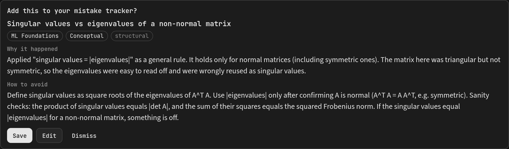
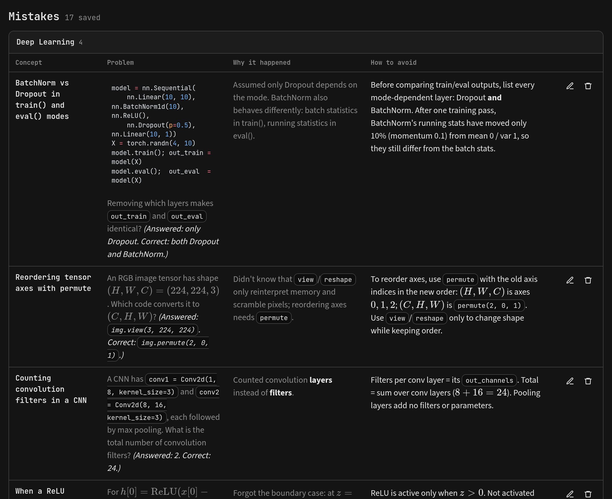
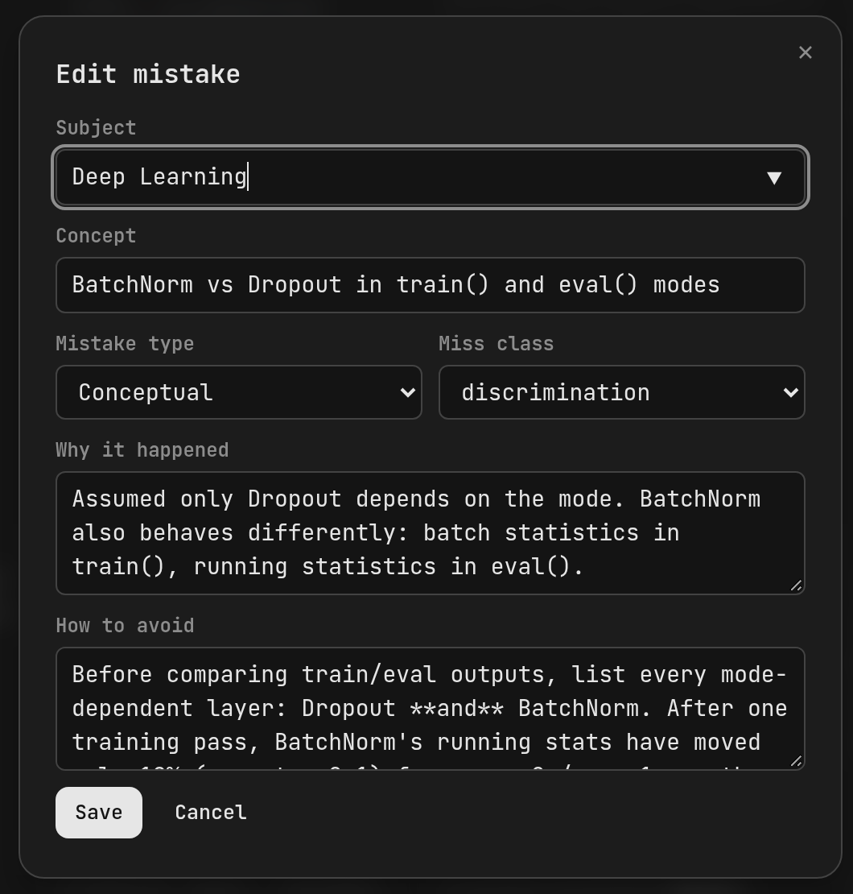

# Mistracker for LearnHarness

A mistake tracker that fills itself while you practice.

When the LearnHarness **practice agent** concludes a problem where your answer exposed
a real gap in your thinking, it drafts one mistake entry: what concept you missed, *why*
it happened and *how to avoid it* next time. You **Save**, **Edit** or **Dismiss** it
right in the session. Saved entries live in a **Mistracker** view, grouped by subject,
in a table built for a quick review before an exam.





## What gets proposed (and what doesn't)

The agent is told to stay quiet unless the miss is worth remembering:

| Your answer | Proposal? |
|---|---|
| A conceptual gap, a misapplied method, or a missing fact or formula | One entry |
| A one-off arithmetic slip or typo | No |
| A mistake you caught and fixed yourself before answering | No |
| A correct answer | No |

At most one entry per problem, and only after the agent concludes it. The agent reuses
your existing subjects where they fit, so entries group cleanly. It never mentions the
tracker in its replies; the card is the only trace.

Each entry has:

- Subject and concept (the concept renders Markdown and LaTeX)
- Mistake type: Conceptual, New info/detail, Calculation or Memory/Formula
- Miss class, the same one the practice agent uses when it concludes: cue,
  discrimination, execution, careless or structural
- Why it happened and how to avoid it: short, first-person notes written for a quick
  scan before an exam (Markdown, LaTeX math and code blocks supported)
- The problem statement and a link back to the session. Long problems are clipped to
  about six lines in the library, with a **Show more** toggle

Everything is editable afterwards:



## Install

Requires LearnHarness **0.6.0** or newer.

1. Download `mistracker-<version>.zip` from the
   [latest release](https://github.com/hrdkj/mistracker-plugin/releases/latest).
2. Extract it into your **plugins directory**, the path shown in
   LearnHarness **Settings → Community plugins**. You should end up with
   `<plugins-directory>/mistracker/dist/manifest.json`.
3. In **Settings → Community plugins**, click **Refresh** and enable **Mistracker**.
4. Start a **Practice** session. Mistracker appears in the sidebar.

To update, replace `mistracker/dist/` with the new version and restart LearnHarness.
Your entries live in the sibling `mistracker/data/` folder and are kept.

> Community plugins run with the same access as LearnHarness itself. Install code you trust.

## Build from source

Needs Node 22+ and a LearnHarness checkout next to this repository at `../learnharness`
(used only to generate the type-only plugin SDK).

```sh
npm run sdk            # generate .sdk/ type definitions from ../learnharness
npm ci
npm run typecheck && npm test
npm run build          # writes dist/
npm run install-dev    # copies dist/ into ../learnharness/data/plugins/mistracker
npm run package        # writes release/mistracker-<version>.zip
```

`install-dev` respects `LH_DATA_DIR` if you use a different learning-data profile.
Restart the app after installing changed code; LearnHarness has no plugin hot reload.

## Known limits

- **Practice sessions only.** Teaching sessions (probe → plan → teach) don't propose
  entries.
- **No images.** Entries keep the problem statement text, not screenshots.
- Saving or dismissing changes only Mistracker's own data. The agent's original tool
  result stays in the transcript unchanged.
- No spaced review yet.

## Ideas

- Attach images to entries, which needs host-provided plugin file storage.
- Turn saved mistakes into flashcards with the Flashcards plugin.

## License

[AGPL-3.0-only](LICENSE), the same as LearnHarness.
